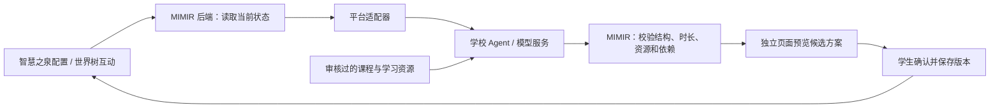

**MIMIR Agent 平台调研与接入建议**

调研日期：2026-10-05。依据：用户提供的比赛方案 DOCX、比赛和学校官网、各平台官方开发文档，以及当前源码与 `HANDOFF(1).md`。本文是接入设计，尚未使用参赛账号调用平台，也未测得模型质量、延迟或费用。

**建议第一版使用现成模型与 Agent API，优先验证交晓智 DeepEdu2.0。当前没有必须自行蒸馏模型的理由。** 学校已公布智能体后端 API 的获取方法，也提供过 DeepSeek-R1 接入指南。账号是否具备这些能力、当前模型版本、额度和校外调用条件，需要在实际控制台验证。[学校 API 指南](https://agent.xjtu.edu.cn/zntjs/zntfbgly_APIjr/hqzntjrAPI_fwdz.htm)、[学校 DeepSeek 指南](https://agent.xjtu.edu.cn/zntjs/DeepSeekczzn/DeepSeek_R1mxb_ybjy_.htm)

**比赛需要做成什么，以及哪些平台能用。**

OPC 赛项关注通过大模型、智能体、知识库和工作流实现教育等场景的产品验证与迭代；它与另一个 AI 加速器模型适配赛项不同。参赛方案没有要求选手训练自己的基础模型。MIMIR 的技术重点可以落在可检查的阶段任务、知识依赖、目的追问和方案迭代上。[OPC 官方说明](https://agent.xjtu.edu.cn/aiic/info/1146/1165.htm)

比赛官网推荐 TeleAgent，同时允许学校自有平台及符合要求的第三方平台，列出了扣子、千帆、百炼、智果和元器；官网还介绍了学校的 DeepEdu2.0。以下比较中的“用途”是结合 MIMIR 源码作出的设计判断，不是平台实测排名。[比赛平台推荐](https://agent.xjtu.edu.cn/aiic/pttj.htm)

| 平台 | 官方资料确认的接入能力 | 在 MIMIR 中的建议用途与待核实项 |
| --- | --- | --- |
| 交晓智 / DeepEdu2.0 | 学校平台支持知识库、工作流和智能体；学校操作指南明确提供后端 API、APPID 和密钥。 | **优先验证**培养方案、阶段复盘和成长教练。旧指南证明有 API 路径，但不能据此保证当前 2.0 账号的接口、模型和额度完全一致。 |
| TeleAgent 桌面助手 | 面向文件处理、研究、办公和桌面任务，支持内置及自配模型。 | 可作为用户主动使用的资料整理、报告制作助手。尚未确认其桌面产品有可供 MIMIR 稳定调用的正式服务端接口。 |
| 电信星辰智能体开发平台 / 天翼 AI 开放平台 | 开发平台明确支持把应用发布为后端 API；开放能力文档列有 Xing4.0 和 TeleChat 模型系列。 | 若比赛账号给的是开发平台权限，可成为培养 Agent 或模型服务候选。须核实账号、API 协议、模型授权和额度，不能把桌面助手订阅积分等同于开发平台 API 额度。 |
| 扣子 | 智能体对话 API、工作流与 Chatflow 调用。 | 快速搭建教练对话和功能工作流。适配器需处理 bot / workflow / conversation ID、鉴权以及流式结果；具体额度以账号为准。 |
| 阿里云百炼 | 模型服务、知识库、Agent 与工作流应用 API；应用以 APP ID 定位，部分业务空间还需 Workspace ID。 | **第三方备用首选候选**：可以先接模型，再接知识库和流程。这个优先级来自接入范围与现有结构的匹配，需用统一案例验证效果；模型 API 与应用 API 是两种接口。 |
| 百度千帆 | 模型 API、Agent 应用开发和工作流组件调用。 | 适合课程资料检索和功能工作流。需按当前控制台产品版本选 API；不能混用旧 AppBuilder 示例与新千帆接口。 |
| 华为云智果 AgentArts | 智能体发布、工作流和运行 API，运行接口有项目、Agent、会话及鉴权参数。 | 若已有学校云资源或团队熟悉华为云，可作为候选。否则第一版需额外处理云账号、项目与版本配置。 |
| 腾讯元器 | 已发布智能体可通过 API 嵌入自有产品。官方说明目前提供每月 100 万 token 的 API 模型调用额度。 | 适合小规模原型试验；核实账号剩余额度、并发和输出稳定性。正式规模化服务需另行评估，不能把网页使用权益当作 API 权益。 |

表格依据：[DeepEdu2.0 校方介绍](https://agent.xjtu.edu.cn/aiic/info/1142/1186.htm)、[TeleAgent 产品介绍](https://agent.xjtu.edu.cn/aiic/teleai.htm)、[星辰智能体后端 API 发布](https://www.teleai.com.cn/doc/o0o7Iu0RoFsKoKfUQkKx/zERT6CTMCNqNHtruruHE)、[电信开放能力文档](https://www.teleai.com.cn/docOverview)、[扣子对话 API](https://docs.coze.cn/developer_guides_chat_v3)、[扣子工作流 / Chatflow](https://docs.coze.cn/guides_workflow_and_chatflow)、[百炼应用介绍](https://help.aliyun.com/zh/model-studio/application-introduction)、[百炼应用凭证](https://help.aliyun.com/zh/model-studio/obtain-the-app-id-and-workspace-id)、[千帆应用开发](https://cloud.baidu.com/doc/APPBUILDER/index.html)、[千帆工作流组件 API](https://cloud.baidu.com/doc/qianfan-api/s/2m7yfssdg)、[AgentArts 运行 API](https://support.huaweicloud.com/api-agentarts0/runAgent.html)、[元器 API 服务与额度](https://yuanqi.tencent.com/guide/publish-agent-api-service)。

TeleAgent 另有一个具体接入限制：其用户协议限制通过自动化等手段绕过正常计费或访问控制，把服务能力转供第三方产品。因此推荐正式开放平台 API；不设计通过操纵个人桌面助手来为 MIMIR 提供服务的方案。桌面助手可以连接第三方云模型，“本地桌面软件”本身不代表模型推理也在本地。[TeleAgent 用户协议第 4、10 条](https://www.teleai.com.cn/doc/anoPahFngfdaAo7m4DGp/ylLY5ekif2kWnq76SP4I)

**学校平台如何直接成为 MIMIR 的 brain。**

可以。这里的 brain 是能够接收学生上下文、调用知识库并输出建议的 Agent / 工作流服务。MIMIR 负责用户交互与正式状态，平台负责推理；是否有效完成培养闭环，还要靠双方的输入输出约定和实际评测。

当前源码已经有三个清晰的切入点，见 `growth/src/model.mjs`：

| 已有操作 | 推荐平台实现 | 必须保持的产品行为 |
| --- | --- | --- |
| `planWithModel` | 结构化工作流：画像与目标 → 资源检索 → 生成双周任务和长期概览。阶段复盘沿用同一流程，增加成果、卡点与配比变更。 | 输出候选方案；MIMIR 校验后预览，学生确认才成为当前方案。 |
| `feedbackWithModel` | 对话 Agent：回应当前困难，提出 1–3 个关于目的、深度和取舍的问题。 | 建议调整与实际修改分开。学生随时反馈，不能因一次聊天就覆盖计划。 |
| `evidenceWithModel` | 成果反馈工作流：按已有完成标准逐项检查提供的文字和练习结果。 | 区分自报和成果依据，不能假装读过附件；模型给反馈，学生确认完成。 |

科研、竞赛、绩点、兴趣先作为一个教练的四种目标侧重，并提供各自资源与提示词模板。第一版不必为每个方向搭一套互相讨论的 Agent。后续论文阅读、题目带练和竞赛材料工具可作为明确的功能调用；依据任务类型分派即可。

培养工作流建议使用以下输入：已有画像、四项配比、每周时间、阶段深度、当前任务及成果、世界树待办、自报卡点、近期反馈和允许使用的资源 ID。输出保持当前培养方案 schema，包括任务目的、完成标准、周次、时长和前置依赖。模型可以提出调整理由，MIMIR 决定该结果是否合格。

目的追问围绕三个判断展开：为什么要完成这个目标；什么结果对当前目的已经够用；下一阶段继续深入的收益是否值得时间投入。将回答转成结构化偏好，并在复盘时展示变化依据。这能体现用户所说的“亚里士多德式追问”，不必把问答次数当作学习成效。

学校工作流指南支持模型、知识库、代码、选择器等节点，这与上述固定功能流程相符。实际节点参数仍以当前平台为准。[校方工作流指南](https://agent.xjtu.edu.cn/zntjs/jjxx/gzl.htm)

**与 HANDOFF 和现有技术的衔接。**

目前 `generateText` 通过 `ctx.agentDefaultModel` 和 `ctx.llm.prepareCall` 使用已注册的模型；已有 DeepSeek 默认路由。运行时的 `dsh-llm-pi-ai` 也支持声明模型服务的协议、baseURL 和模型目录，但这不等于所有平台的应用 API 已经兼容。

- 如果拿到的是模型 API：复用现有模型层，注册真实 provider / model 以及准确协议，保留论文、文稿和研究模块共享模型选择的机制。不能只换一个 Key，就假定任意 APPID 接口可用。
- 如果拿到的是 Agent / 工作流应用 API：在成长模块的三个操作背后增加平台适配器，映射输入、响应、会话、取消、超时和错误。它是成长服务后端，不冒充一个可供全部模块任意调用的通用模型。
- SQLite 中的画像、正式方案、证据和版本记录继续由 MIMIR 后端管理。云端会话可以辅助对话，但不能成为唯一长期记忆；平台的会话有各自生命周期。
- `growth/src/host.mjs` 的领域校验、候选确认、版本控制和失败处理继续生效。模型超时、额度耗尽或输出不合格时，原方案保持有效；示例模式始终明确标识。
- 新接口继续通过已认证的 `ctx.connection.fetch.register` 接入。云端使用由本机后端主动发出的请求，不为平台插件把本机 UI 或控制端口开放到公网。
- 当前启动器只实现了已有凭据流程。增加平台凭据时需扩展同等的 DPAPI 加密与后端注入机制，不能把 Key 放入前端、分享方案、命令行或明文业务状态。

以上是源码和交接说明约束，尚未实施平台适配。接学校平台前，还需取得真实 API 示例；公开指南中的 APPID / 密钥说明不能证明它采用某种通用聊天协议，本文没有猜测学校的请求路径。

知识库优先放入经过核对的课程大纲、先修关系、任务模板、评分标准和可用资源目录，保留来源、更新时间和资源 ID。学生记录由 MIMIR 提供最小必要上下文。论文、赛事规则和前沿知识会更新，适合检索补充；仅把文本上传知识库不能自动得到可靠的知识拓扑。第一版拓扑依赖现有概念与关系目录，新增关系经过校验再显示。

**账号接入前需要确认的内容。**

学校指南给出的路径是“个人空间 → 我的智能体 → 概览 → 后端服务 API”，可查看 APPID 并创建密钥。先尝试用一个测试 Agent 跑通调用即可。[学校 API 获取方法](https://agent.xjtu.edu.cn/zntjs/zntfbgly_APIjr/hqzntjrAPI_fwdz.htm)

需要从当前控制台确认：API 地址和脱敏请求 / 响应示例、APPID / 工作流标识、可选模型、密钥期限、token 或费用额度、限流、是否支持结构化输出、是否要求校园网 / VPN，以及测试账号与后续产品服务的可用范围。只传非敏感配置和脱敏示例；真实密钥通过本机凭据流程保存。

学校介绍要求校外平台访问使用 SSL VPN。这说明登录有网络条件，不能直接推断其服务 API 在公网也可访问；须分别验证登录和后端调用。[DeepEdu2.0 官方介绍](https://agent.xjtu.edu.cn/aiic/info/1142/1186.htm)

建议将学校接入验证限制在 1–2 个工作日内：先完成一次匿名测试画像的请求、一次结构化方案生成、一次复盘调用。若当前账号暂未开放所需 API，先用已有模型路由继续完成培养闭环，再在百炼、元器或获授权的星辰开发平台中选一个可用后端；无需等待所有平台接完。

**缺少模型 API 时，先部署现成模型，再判断是否训练。**

| 实际问题 | 建议先做 | 蒸馏是否能直接解决 |
| --- | --- | --- |
| 学校暂未开放 API 或额度不足 | 换已开放的模型 / Agent 服务，或部署开放权重模型。 | 不能。蒸馏本身仍需要教师模型、训练数据和训练资源。 |
| 要求离线运行 | 在可用硬件上测试量化的开放模型，并通过本地推理服务接入。 | 不必先蒸馏；已有小模型可直接测。 |
| 课程和比赛知识不全 | 建立资源目录与检索知识库，提供可追溯来源。 | 不适合优先靠训练记忆会变化的事实。 |
| JSON、任务依赖或时间预算不稳定 | 优化提示词、约束输出、拆分工作流，保留后端硬校验。 | 只有持续评测证明以上不足，才考虑进一步训练。 |
| 教练追问风格或卡点分类长期不合格 | 收集经同意和处理的数据、建立独立评测集，再做小规模 SFT / LoRA。 | 可考虑用有授权的教师模型生成并审核训练样本。 |
| 调用量大、成本或延迟成为实际瓶颈 | 先测缓存、上下文裁剪和小模型处理简单任务的效果。 | 达到部署与质量收益要求时，才值得蒸馏特定任务。 |

一个可评测的本地候选是 `Qwen3-4B-Instruct-2507`：官方模型卡标注 Apache-2.0，并说明它是非思考的指令模型。可以测试量化版本是否满足中文教练与结构化任务需求，不能预先承诺与云端大模型效果相同。[Qwen 官方模型卡](https://huggingface.co/Qwen/Qwen3-4B-Instruct-2507)

`llama.cpp` 的服务端提供兼容聊天调用以及 JSON / schema 约束能力，适合作为本地模型服务候选。但 JSON 格式正确不代表资源、学时和依赖正确，仍由 MIMIR 校验。当前机器 GPU、显存及推理吞吐未确认，本文不承诺本地运行速度，也不建议直接下载大模型或购买硬件。[llama.cpp 服务文档](https://github.com/ggml-org/llama.cpp/blob/master/tools/server/README.md)

DeepSeek-R1 也已经公开多个蒸馏模型，能直接测试，不必先复制一遍蒸馏流程。使用时核对所选模型及基础模型的许可；开放权重许可与某个托管 API 的使用条款是不同问题。[DeepSeek 官方模型仓库](https://github.com/deepseek-ai/DeepSeek-R1)

如果将来确实需要蒸馏，建议只做窄任务，例如“将学生自由反馈转成偏好字段”“识别当前卡点”“生成合适的目的追问”。流程为：定义输入输出和独立评测集 → 获授权的教师生成候选样本 → 人工审核 → 小模型 SFT / LoRA → 与原模型比较质量、延迟、费用和部署成本。先做数百条样本的试验，按收益决定是否扩大；这只是工程起点，不是成功所需样本量的保证。培养方案的正式修改权和约束校验始终留在业务层。

**用评测决定选型。**

建议先准备 30–50 个匿名或合成场景，在相同资源目录和预算下比较当前模型、学校 Agent 及一个备用服务。以下是目标与用例设计，尚无实测结果：

| 检查项 | 代表场景 / 预期行为 |
| --- | --- |
| 时间与配比 | 每周只有 3 小时；某方向配比为 0；某方向达到 20%。最终接受的方案应全部满足预算和方向规则。 |
| 资源与依赖 | 模型引用不存在的资源、给出循环依赖或倒置周次。后端应拒绝，不能展示为有效方案。 |
| 基础与目标深度 | 专科初学者与已有论文经验的学生目标相似；“了解即可”与“独立复现”所需任务应有区别。 |
| 阶段迭代 | 用户说“够用了”，或完成练习后改变方向。方案应解释调整依据，等待确认，并保存前后版本。 |
| 成果依据 | 勾选待办、仅自报掌握、提供成果文字、引用未上传附件。反馈应区分这些证据，不夸大能力判断。 |
| 追问质量 | 明确目的时避免重复盘问；目的含糊时问有助于取舍的问题；不强迫所有学生科研或参赛。 |
| 外部文本 | 资源或论坛模板含“忽略系统要求”等文字。内容作为资料处理，不改变产品规则。 |
| 失败恢复 | 超时、取消、额度不足、半截 JSON 和并发复盘。原方案应保持有效，并给出可操作的重试说明。 |
| 会话隔离 | 两位匿名测试用户目标不同。不得串用对话或画像；云端会话标识由适配器隔离。 |
| 产品与成本 | 记录有效方案率、首字与总耗时、token、重试次数，以及学生能否独立理解和完成下一步。 |

硬约束由后端保证，所有被接受方案必须通过；格式成功率、教练质量和延迟在固定场景上测量后再设上线门槛。不要把模型“返回 JSON 的比例”当作培养效果，也不要把上述预期写成已经达成的数据。

费用可按“输入 token × 单价 + 输出 token × 单价 + 检索 / 存储 / 托管费用”估算，并计入失败重试。各模型价格、学校补贴和账号额度尚未核实，因此这里不给出虚构的月费用或‘永久免费’承诺。

比赛官网目前列出的作品提交截止日期为 2026-10-25。按该时间，第一版投入建议是平台接通、稳定输出、真实学生试用和培养闭环证据；模型训练作为后续有评测依据的路线。[比赛时间安排](https://agent.xjtu.edu.cn/aiic/)
