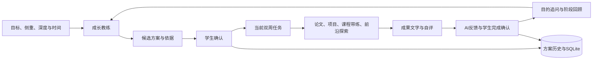

# MIMIR 成长层技术设计

## 产品取舍

智慧之泉是主入口。侧重与深度由学生选择，时间是独立预算约束。默认八周概览、两周可执行任务、第七天轻回顾、第十四天阶段复盘；确认后记录真实日期。学生可随时表达偏好与困难。AI 用目的、基础、证据和反馈提出建议，学生确认后版本才切换。

0.2.0 将页面从长表单改为大入口、六步配置和独立方案页。各步采用选项优先、底部自定义、确认 / 回退与方向转场；方案任务通过弹层预览，再进入独立学习页。密米尔之林的方案库与论坛分别导航；论坛还有独立话题和讨论页。当前本机方案库支持可持久化的 Star 和收藏筛选，不伪造跨用户计数。

## Brain 与执行边界

0.3.0 的世界树将清单、知识地图和阶段路径分开呈现。知识图由注册资源的概念生成，保存在方案快照中展示；只纳入该方案实际使用的资源。连线是知识联系，不附加前置条件；前置约束继续由任务的 `prerequisites` 和服务端完成检查决定。

`journeyFocus[planId]`、`journeyChecklist[taskId]` 和 `journeyObstacles[taskId]` 保存学生选择、逐项自查与卡点。对应 `focus-task`、`check-criterion`、`task-obstacle` 接口沿用版本与请求键，只接受当前方案中的任务。旧数据通过补字段迁移保留原版本与所有内容。自查勾选不生成成果、不代表任务完成；成果保存、学生完成确认和真实前置检查仍独立进行。AI 编排只传入当前方案的自报记录，明确限制模型不得据此宣称知识掌握。

前端完整学习页与任务简记共享每任务草稿，快速保存保留已有成果正文；任务返回、筛选和周次通过按方案的会话内导航缓存恢复。页面刷新后的学习记录来自 SQLite。`plan.stage` 是实际双周阶段序号；`roadmap` 的周次是每份方案的相对远期参考，两者不通过数组索引强行对应。

成长教练是一层状态化业务编排。0.8.0 通过原默认模型选择与包内 DSH `agents.create`、`followup`、`whenIdle`、`dispose` 运行独立 Agent，完成方案生成 / 复盘、即时交流、成果反馈与研究摘要概览。每次注册三个只读学习工具，限制工具、步骤、输出与执行时间，抑制运行环境上下文。模型结果必须经过业务约束校验才能写入；详细边界见 [DSH 接入说明](dsh-integration-2026-10-07.md)。

0.4.0 增加 `learning.mjs` 的分步工作簿和用途追问，`library.mjs` 的课程、自评与历史题工作台，以及 `research.mjs` 的 arXiv 来源检索。学习记录、知识自评、课程练习、工作台与概览通过新增字段迁移保存到原 SQLite 状态，所有写操作继续检查版本和幂等键。课程答案只在服务器验证，不把答案键放入客户端目录；练习反馈不自动决定目标完成。

研究接口仅接受注册方向和 5 / 10 条，服务端请求固定 arXiv 地址；有超时、大小限制、来源 ID 校验、缓存和限流。`research-digest` 让默认模型整理真实返回的摘要片段，再验证返回 ID 集合；网络或模型错误不生成假论文。培养模型上下文仅传当前阶段工作簿和学习记录，标明这些是学生自报。平台连接仍沿用原 DSH，尚未接入学校 API。

允许资源来自本地注册目录。任务必须引用现有资源 ID，科研 / 竞赛 / 绩点 / 兴趣方向必须匹配；不能以编造链接补全资源。原论文导读与文稿工作台继续负责专业执行，成长层负责串联入口和成果回收。本版不会自动驱动这些界面或读取尚未提供的附件。

比赛平台 Agent 未来可替换 `growth/src/model.mjs` 中的适配入口，其他培养状态和前端保持不变。本版选用原有 DSH 作为运行基础；赛事是否接受这一具体提交，应按主办方最终提交平台与要求核对，不能把「允许第三方平台」等同于已获得认证。

## 状态与确认

所有写操作使用版本号与请求键。相同请求可重放已有结果，重复点击不会重复写入；并发冲突要求刷新，不会悄悄覆盖。模型调用完成前不持有 SQLite 写事务；返回后再次检查版本。取消、超时、非法输出或连接失败都不能切换当前方案。

模型先产生 `draft`。用户确认后旧版本成为 `historical`，其他旧候选失效。0.11.0 起完整重新配置、复盘修订和导入适配以实际确认时刻重设双周日期；仅未推进阶段的 `course-*` 候选沿用当前阶段日期，推进阶段重新计时。历史任务与证据继续保留，新阶段任务独立创建。成果提交与完成确认是两步，AI 判断不直接代表完成或实际掌握。

SQLite 保存在 `<data-home>/mimir-growth/growth.sqlite`，记录状态、请求幂等结果和基本事件。每个数据目录对应一个本机学习者；复用原产品的浏览器认证和跨来源写入拒绝。当前结构适合个人本机试用，多用户上线需要另建用户身份、行级权限与在线社区服务。

既有状态读取时补齐 `sharedPlans` 与 `starredPlanIds`，无需清空原有学习记录。共享模板在进入预览前经服务端校验并筛选允许字段；本机保存按内容指纹去重。Star 使用显式目标布尔值，重放请求不会重复计数。

## 扩展资源

`growth/src/catalog.mjs` 是首版资源目录。每条资源具有稳定 ID、方向、内容、完成标准和可选练习。UI 根据资源类型展示内容或跳转原模块；服务端验证资源存在并匹配方向。后续模块应沿用这一契约，再增加自己的业务接口。需要新资源类型时同步前端呈现与后端校验。

首版内置：机器人论文阅读工作坊、机械臂分拣单元设计、两连杆运动学基础练习、具身智能探索。项目内容是学习案例，不声称对应某场比赛的最新赛题；论文原文需要学生自行提供。

## 运行包改动范围

保持原 ZIP 与用户已有解压目录；新增独立 `runtime/`。只在运行包启动 bundle 列表与依赖清单中注册 `@mimir/growth-layer`，将新增模块复制进包内。扩展客户端复用现有 React、布局与侧栏；对原侧栏进行组件包装，保留其子插槽。基线加覆盖文件的 SHA-256 可独立校验。

修改后的实际源文件、构建与安装脚本均在工作区；不依赖上游未交付的完整开发仓库。
