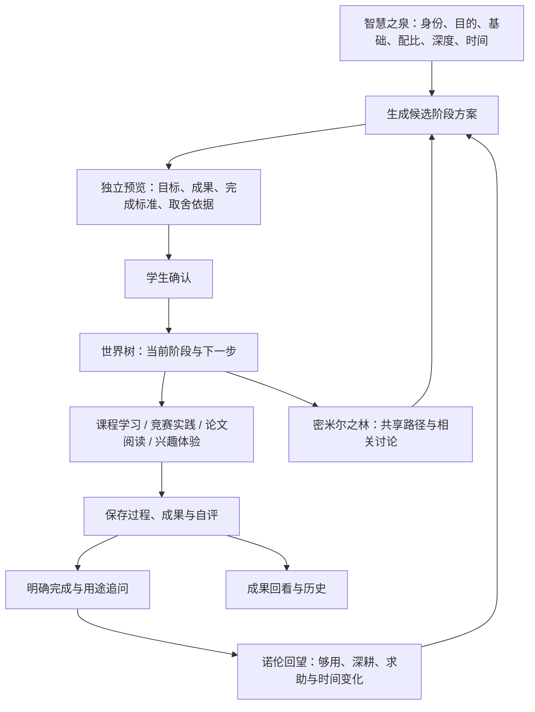
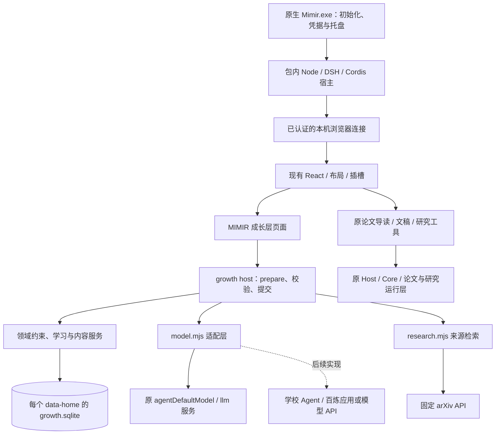

# MIMIR 总计划、系统架构与开发交接报告

**2026-10-08 最新补充：当前成长层为0.10.0。《提示词4》已实现四个新增深入学习主题及自定义主题、九类“其他”表单置顶、个人补充编辑删除和研究选择反馈。论文定位与选区稳定，拖选菜单包含取消高亮；重复高亮颜色不变，无高亮时取消无效。各AI入口补耗时与失败提示，延长时限、约束历史摘要并完善错误分类。字体大小及右对齐按用户最新要求暂缓。93项单元检查、23组原生／浏览器场景及9组DSH Agent集成场景通过，个人学习数据库保持不变，真实在线质量未验收。当前工作区为 `D:\Xiaorui Wang\AI+竞赛资料\ai4edu-MIMIR (2)\ai4edu-MIMIR`，精简交付为 `artifacts/MIMIR-growth-0.10.0.zip`，已安装的运行目录可直接重启体验。详见 [提示词4说明](prompt4-2026-10-08.md)、[AI稳定性说明](ai-stability-2026-10-08.md) 和 [验收记录](validation.md)。以下为历史背景。**

**2026-10-07 最新补充：当前成长层为 0.9.0。提示词3的六项要求已实现：研究页显示并切换具体模型；首页标题单行与响应式布局；导航改为“我的成长计划”；八类“其他”可新建并保存；个人目标支持多条；原生 Mimir 设置包含模型和 API Key 保存入口，实际接入 DSH 默认模型与凭据服务。75 项单元检查、9 组新增原生／浏览器检查及 9 组 DSH Agent 检查通过，真实在线模型质量仍未验收。源码和当前文档位于 `D:\Xiaorui Wang\AI+竞赛资料\ai4edu-MIMIR (2)\ai4edu-MIMIR`，最新精简包为 `artifacts/MIMIR-growth-0.9.0.zip`。详见 [本轮说明](customization-2026-10-07.md) 和 [验收记录](validation.md)。下文各版本号及旧电脑路径保留为历史背景。**

**2026-10-07 接手补充：当前成长层为 0.8.0。成长、学习和研究的 AI 入口已实际使用包内 DSH Agent，复用原模型与凭据，并注册三个只读学习工具；真实在线模型效果仍待验收。接入与边界见 [DSH 接入说明](dsh-integration-2026-10-07.md)。路径2日常体验、浏览器草稿恢复和资源搜索已完善；路径3新增二连杆机械臂运动学专题，包含先修诊断、专用预测验证工作台、报告导出和专题知识图。已有课程绑定、下一步候选、8门核心课推荐、资料检索和清单勾选划线继续保留。旧机器人单元仅在显式专题升级后改变规则，其他课程选择和普通回望保留原成果与完成状态。当前工作区为 `D:\Xiaorui Wang\AI+竞赛资料\ai4edu-MIMIR (2)\ai4edu-MIMIR`。最新说明见 [运动学专题](robotics-topic-2026-10-07.md)、[日常体验](daily-experience-2026-10-07.md)、[核心课与推荐](core-curriculum-2026-10-07.md)、[课程闭环](course-loop-2026-10-06.md)、[验收记录](validation.md)。最新精简包为 `artifacts/MIMIR-growth-0.8.0.zip`；下文保留原0.4.0交接背景和原电脑路径，属于历史记录。**

**交接日期：2026-10-06。当前成长层版本：0.4.0。上游运行包：Mimir 0.12.0-beta.1 Windows x64。**

工作区绝对路径：`C:\Users\11762\Desktop\ai4edu-MIMIR`。本文中的目录路径均相对此工作区；文档链接相对此报告所在的 `docs/` 目录。

本报告面向下一位产品与开发负责人，依据用户历次要求、当前源码、上游交接说明、2026-10-05 验收材料和最新产品自查整理。**本次工作是源码与文档核对、交接整理，没有重新运行完整应用验收，没有新增真实学生试用或真实模型调用。**

当前结论：培养产品的导航、配置、候选确认、分步学习、成果保存和阶段回望已有可运行基础；长期培养所需的个性化决策、跨模块内容绑定、计划延续和学习内容深度仍明显不足。接手后的重点应是把现有闭环做实。学校 / 百炼接入按用户最新决定暂缓，不能让接口等待阻断产品迭代。

## 1. 接手时先知道的决定

| 项目 | 已确定的方向 |
| --- | --- |
| 产品 | MIMIR，沿守护智慧之泉的神话故事线命名；名称同时要帮助用户理解功能 |
| 对象 | 本科、专科学生；首先以智能制造、机器人与智能产线作为具体示范 |
| 核心价值 | 学生自主选择成长目标，Agent 提出阶段方案，通过行动、成果和目的反馈持续调整 |
| 四个方向 | 科研、竞赛、绩点 / 课程学习、兴趣；配比表达投入侧重，不是能力分数 |
| 主入口 | Mímisbrunnr，中文界面使用“智慧之泉”；大入口、分页面配置 |
| 配置方式 | 选项优先，底部允许自由表达；确认 / 回退与转场，参考 NBA 2K 配置体验 |
| 方案方式 | 独立预览，每项有目的、成果和完成标准；确认后才切换当前方案 |
| 培养周期 | 双周可执行阶段，长期概览；第 7 天轻回顾，第 14 天阶段复盘，可随时反馈 |
| 学习方式 | 可交互清单、知识关系、具体练习和工作坊，保留成果与自评 |
| 反馈方式 | “够用 / 深耕 / 求助”以及关于目的、偏好、投入的追问；变化须形成候选并确认 |
| 社区 | 方案共享、类似 GitHub 的 Star、同好论坛；森林下分别导航 |
| 交付形态 | 继续浏览器界面和现有原生启动器；Electron 暂缓 |
| 模型平台 | 原模型接口仍可用；学校 DeepEdu2.0 / 百炼适配暂留空，当前先完善功能 |
| 训练路线 | 未训练或蒸馏任何模型；没有依据将蒸馏列为第一优先级 |

培养方案指学生自己的成长选择，不代替学校正式学分、毕业或教学培养方案。当前机器人示范也不能宣传为已经覆盖所有专业。

**冲突处理顺序：**产品思路以用户最新明确要求为准；涉及原工程技术边界，以 [HANDOFF(1).md](../HANDOFF%281%29.md) 为准。本文描述当前适配层和后续计划。历史调研中的平台接入优先级、早期世界树文档中的“以后做”，需要结合最新决定和 0.4.0 实现阅读，不能直接当作现阶段开发指令。

## 2. 总体产品计划

### 2.1 要形成的使用闭环



此图表达总计划。当前“成果统一回看”“相关讨论联动”“反馈真正改变任务内容”等环节只部分实现或尚未实现，不能仅凭箭头认为已经打通。

### 2.2 页面与模块安排

| 产品模块 | 应承担的职责 | 当前入口与状态 |
| --- | --- | --- |
| 智慧之泉 | 建立目标画像、配比、深度、时间与基础，生成和确认方案 | 首页大入口，六步配置，独立候选页；已实现 |
| 世界树 | 当前阶段的行动、知识关系、下一步、卡点、过程和历史 | 顶部导航，行动清单 / 知识地图 / 阶段路径；已实现基础 |
| 知识与实践 | 课程、竞赛、研究、兴趣的内容入口和具体工作区 | 首页四张卡片、左侧四个快捷入口；已实现首批内容 |
| 诺伦回望 | 目的与投入回顾、随时反馈、生成修订或下一阶段候选 | 顶部导航，分页面回望；反馈记录已实现，决策深度不足 |
| 密米尔之林 | 共享方案与同好论坛 | 顶部导航，两个独立子入口；当前本机演示 |
| 原论文导读与文稿工具 | PDF 阅读、批注、研究材料和专业文稿工作 | 原侧栏入口保留；成长层尚未自动消费附件或绑定真实成果 |
| 统一成果架 | 汇集各阶段阅读卡、解题、设计和验证成果 | 规划项；当前只能到具体任务、工作台或历史中寻找 |

不要继续把全部内容铺在一个长页面中。已有分页面框架应保留，下一轮通过“继续上次学习”“当前目标相关资源”等入口减轻寻找成本，而不是增加更多难以理解的神话导航名。

### 2.3 四方向最终应具备的能力

- **学习 / 绩点：**统一知识图谱、先修诊断、公开课的具体小段、练习与问答、错误提示、重练和迁移解释。课程完成记录与概念证据关联，不用勾选次数声称掌握。
- **竞赛：**依据学段、基础、团队和设备条件推荐赛事；往年题有可追溯来源；至少一个题型具有需求拆解、方案结构、测试用例和实际结果记录的专用工作台。
- **科研：**近期研究检索、阅读队列、来源与问题 / 方法 / 证据卡片、逐步连接原论文模块。中文概览是摘要辅助，不能替代全文阅读或暗示已同行评审。
- **兴趣：**不同方向有不同的短体验，记录喜欢与费劲的原因；通过多次体验形成偏好，允许不确定、暂停和换方向。

首版应在一个机器人示范方向中把这些过程做完整，再通过统一内容契约扩展专业。现有资源量不足以让 Agent 随意生成任意专业课程体系。

## 3. 当前完成到哪里

### 3.1 版本推进

| 适配层版本 | 本轮主要成果 |
| --- | --- |
| 0.1.0 | 恢复运行环境，加入个人成长层，建立配置、候选、确认、学习记录与复盘基础 |
| 0.2.0 | 按用户意见拆成大入口、六步配置、独立方案预览；森林分开方案库与论坛；加入本地 Star |
| 0.3.0 | 世界树交互清单、个人自查、下一步、卡点、知识拓扑、阶段路径与历史只读 |
| 0.4.0 | 分步学习工作坊、目的追问、公开课知识图谱与练习、历年题工作台、真实 arXiv 检索、明显的四方向入口 |
| 0.4.0 后的自查 | 形成产品差距、源码反例与下一轮验收任务；没有把这些未来要求实现进产品 |
| 本次交接 | 整理本报告和 README 入口；不改变业务功能，不重发旧 ZIP |

成长层的 `0.4.0` 和上游整包的 `0.12.0-beta.1` 是两个版本，不应混为一个产品版本号。

### 3.2 已有可运行功能与实际限制

| 功能 | 已实现内容 | 目前边界 |
| --- | --- | --- |
| 配置 | 身份、目的与目标、四方向配比、深度、时间与基础、最终确认六步；回退与自定义输入 | 默认专业、年级和基础仍偏示范画像；未做真正初始诊断 |
| 候选方案 | 独立预览、每项目的 / 成果 / 标准、分周、确认 / 拒绝；预算和资源校验 | 本地模式仍是固定机器人模板；真实模型输出质量未验证 |
| 世界树清单 | 展开任务、自查、固定下一步、卡点、简记、筛选、完成与撤回 | 下一步主要来自规则和任务状态；自查不代表知识掌握 |
| 世界树地图 | 12 个教学概念、关系高亮、方向聚焦、缩放、键盘操作、任务跳转 | 与课程的 8 概念图没有统一 ID；节点颜色来自关联任务进度 |
| 阶段路径 | 双周任务、远期成果预览、第 7 / 14 天页面内提示、历史只读 | 没有后台通知；过期与未完成工作的延续处理不完善 |
| 论文工作坊 | 来源、问题、方法、论据 / 页码、局限、阅读卡和自评 | 文字输入为主；没有自动获取原 PDF 的已授权证据 |
| 项目工作坊 | 输入输出、约束、正常流程、不同异常、指标与验证报告 | 当前是分拣案例，不是任意赛题执行环境 |
| 课程工作坊 | 二连杆角度预测与可视实验、服务端检查问答、迁移解释 | 任务类型单一；课程选择和此工作坊可能不匹配 |
| 兴趣工作坊 | 场景选择、感知 / 规划 / 执行分类、问题与小实验 | 多个入口仍进入同一通用内容，方向差异不足 |
| 学习过程 | 四页流程、三块实践、过程保存、成果编辑、自评、明确完成、用途追问 | 10 / 20 / 40 分钟没有实际裁剪学习动作；未保存草稿会丢失 |
| 阶段反馈 | 够用 / 深耕 / 求助记录、卡点、三页回望、配比与深度调整候选 | 本地复盘重复模板；缺少任务增删的差异和成果延续 |
| 课程库 | 4 门官方公开课程、8 概念、每门 2 道原创问答、自评与保存 | 链接学习；没有章节进度、充分题库或个性化诊断 |
| 竞赛库 | 3 个赛事、4 个历史题 / 规则入口、四步工作台、草稿恢复、Markdown 导出 | 推荐条件不够细；工作台多为表单，不执行代码或仿真 |
| 前沿研究 | 4 个固定方向，真实联网 Top 5 / 10，来源、日期、摘要和原文 | 按新近程度排序；没有个人阅读队列、收藏或全文分析 |
| 中文概览 | 默认模型整理实际返回的摘要，并验证论文 ID 集合 | 只有 mock 流程验证，真实模型质量未验收；依赖有效凭据 |
| 内容带入目标 | 课程、报告、研究草稿可打开当前方向的学习页 | 只按方向找首个未完成任务，可能进入错误工作坊；尚非结构化联动 |
| 方案共享 | JSON / Markdown 导出、白名单导入、再适配、保存去重、本地 Star 与筛选 | 非在线共享；适配会清除任务前置依赖，需要修复 |
| 论坛 | 两个示例话题、独立讨论页、本机回复持久化 | 没有新建主题、公共账号、跨用户消息和真实热度 |
| 原模块兼容 | 原论文与文稿入口、主题、减少动画、窄屏布局保留 | 兼容验收不等于原工具全部功能重新验收 |

### 3.3 首批内容的实际数量

| 目录 | 内容 |
| --- | --- |
| 培养任务资源 | 4 个：`robot-paper`、`sorting-cell`、`robot-kinematics`、`embodied-explore` |
| 世界树概念 | 12 个，按四个培养资源各 3 个概念关联 |
| 课程概念 | 8 个：向量矩阵、坐标变换、运动学、动力学、控制、规划、感知、系统验证 |
| 公开课程 | MIT 18.06、MIT 2.12、Modern Robotics、MIT Underactuated Robotics |
| 课程问答 | 8 道原创选择题；另外培养资源中有 2 道二连杆题，两个题目目录不要混算 |
| 推荐赛事 | 全国大学生电子设计竞赛、全国大学生数学建模竞赛、RoboMaster 高校系列赛 |
| 历史入口 | 2025 电赛 C 题、K 题，2025 数模题集自选题，2025 RoboMaster 规则拆解 |
| 研究方向 | 机器人学习、具身智能、运动规划、人机协作 |

其中数模是官方历史题包入口，RoboMaster 是规则训练，不能都说成已逐题实现的“真题库”。课程与赛事来源的最近核对记录见源码与历史调研，更新内容或提交参赛材料前需要重新核对官方来源。

## 4. 大架构与技术边界

### 4.1 当前真实架构



应用使用上游已交付的 Windows 运行包，新增 `@mimir/growth-layer`。没有迁移到独立 Vite / Next.js 产品，也没有加入 Electron。原工程完整 pnpm 开发仓库不在这次适配交付中；应从现有 `growth/` 和包内实际文件开始，不要照抄上游 HANDOFF 中不存在于本工作区的仓库目录来构建。

### 4.2 新增层与上游层分工

| 层 | 职责与权威 |
| --- | --- |
| 前端 | 导航、交互、草稿、预览和明确确认；不能直接写 SQLite 或自己授予模型修改权 |
| 成长 Host | 读取当前状态、验证请求、选择资源与模型流程、版本控制、取消和提交 |
| 领域层 | 配比、预算、任务方向、资源、前置条件、方案版本和学习完成规则 |
| 成长 Store | 本机学生画像、计划、记录、反馈、共享与工作台的正式状态 |
| LLM / 云 Agent | 产生候选、教练回复、成果反馈或研究概览；不直接决定正式完成或覆盖计划 |
| 原论文 / Core 工具 | 真实 PDF、批注、文稿、授权与研究执行，继续遵循原技术契约 |

浏览器、成长层和未来云端会话都不能代替本机正式状态。原工具在 Windows 用户权限下执行，不是操作系统沙箱；本轮新增工作台没有引入任意代码执行。

### 4.3 安装覆盖范围

构建生成 `growth/lib/client.js`。安装将 `package.json`、`cordis.patch.yml`、`src/`、`lib/` 复制至：

```text
runtime/system/engine/node_modules/@mimir/growth-layer/
```

同时在 `runtime/system/app/environment.mjs` 的 bundle 列表和 `runtime/system/engine/package.json` 的依赖中注册该层。安装覆盖清单由 `artifacts/growth-overlay.json` 记录，当前为 15 个路径，其中包含这两个原文件的定点注册改动。

原 ZIP 和用户原解压目录保留。`runtime/` 是另行恢复并安装成长层的运行目录。前端使用上游 React 与布局插槽，**不要引入第二份 React、直接替换原插槽生命周期，或只改生成文件而遗漏源文件。**

### 4.4 当前 Agent 是如何工作的

它是有状态的成长业务编排层，并非四个角色互相讨论的多 Agent 系统。

1. 读取目标、配比、深度、每周时间、基础、约束，以及当前阶段任务、成果、自报卡点和学习记录。
2. 将允许资源提供给 `model.mjs`，通过 `ctx.agentDefaultModel.currentSelection()` 与 `ctx.llm.prepareCall(...).stream()` 调用现有默认模型。
3. 方案输出必须符合任务 schema、目录资源与预算约束。模型不能通过编造 URL 扩充目录。
4. 结果保存为 `draft`，进入独立预览。用户确认后才成为 `active`。
5. 成果反馈与即时交流分别处理；反馈意见不会直接改当前方案，AI 判断也不直接标记知识掌握。

现有能力入口为 `planWithModel`、`feedbackWithModel`、`evidenceWithModel`，研究摘要概览复用 `generateText`。模型调用有取消、超时和输出校验；真实模型质量尚未验收。

本地模式必须明确标为规则示例。当前 `templatePlan(profile)` 主要按配比安排时长、按深度追加标准，并没有理解专业、截止时间和历史学习单元。未来需要把规则决策做得更实，再让模型辅助解释或提出候选。

## 5. 数据、状态机与接口

### 5.1 数据位置

本项目根目录启动器默认使用：

```text
data/student-1/
  mimir-growth/growth.sqlite       成长层正式数据
  mimir-workbench/                 原文稿、论文和研究资料
  model.secret                    原模型加密凭据
  instance.json                   活动实例认证 / 控制信息
  profiles/、sessions/、storages/   上游运行配置与会话
```

其他学生使用不同 data-home，例如 `data/student-2/`；每个目录是一个本机学习者，没有公共服务器账号体系。上游独立启动的默认路径与本项目脚本路径不同，应先确认具体实例使用哪个 data-home，不要混用。

备份在相应实例正常退出后复制完整 data-home，保留原身份与文件；不能在活动状态只拷贝 `.sqlite` 而忽略 WAL / SHM。`model.secret` 使用 Windows CurrentUser DPAPI，换机器或账户通常要重新输入凭据。不要将凭据、认证 URL、个人数据库、完整日志或浏览器 profile 放进交接材料和代码包。

### 5.2 SQLite 实际结构

`growth/src/store.mjs` 使用包内 Node 的 `node:sqlite`，当前为三张表：

| 表 | 当前用途 |
| --- | --- |
| `state` | 单行 JSON 状态，包含 `version`、画像、方案与全部成长记录 |
| `requests` | 请求键、请求指纹、已提交结果，用于幂等重放 |
| `events` | 事件序号、时间、操作类别和版本；不是完整学习行为分析仓库 |

主要状态字段：

| 字段 | 含义 |
| --- | --- |
| `profile` / `profileSaved` | 称呼、专业、年级、目标、基础、约束、目的、配比、深度、周预算和路径周数 |
| `activePlanId` / `plans` | 正式方案、候选和历史；方案包含画像快照、任务、远期概览和阶段日期 |
| `evidence[taskId]` | 成果文字、自评、练习、模型评价、提交 / 完成状态 |
| `feedback` / `messages` | 目的选择、困难与教练交流记录 |
| `journeyFocus[planId]` | 当前固定的下一步 |
| `journeyChecklist[taskId]` / `journeyObstacles[taskId]` | 个人自查与卡点 |
| `learningSessions[taskId]` | 当前学习页、实践块、分钟选择、工作簿字段和用途追问 |
| `knowledgeSelfReport` / `coursePractice` | 课程概念自评和服务端检查练习记录 |
| `competitionWorkspaces` | 历史题 / 规则工作台步骤和表单草稿 |
| `researchDigests` | 已保存的研究概览、来源集合与模型标识 |
| `sharedPlans` / `starredPlanIds` / `forum` | 本地共享、收藏和示例主题回复 |

迁移目前采用补充缺失字段，保留版本、旧方案、旧成果和未知字段。后续引入内容引用、稳定学习单元等结构时，必须定义兼容迁移；不能清空数据库以便新版跑通。

**地图的真实存储边界：**`journeyForPlan()` 按方案中的 `resourceId` 与当前教学目录计算节点和连线，再输出到状态响应。当前没有将完整概念与连线版本冻结到每份历史方案。因此更新目录可能改变历史地图展示；`architecture.md` 中“保存在方案快照中展示”的早期表述不能理解为已实现图谱快照版本管理。

### 5.3 必须保留的状态行为

- 所有正式业务写入带 `version` 和 `requestKey`。请求指纹相同可重放结果；同键不同内容拒绝；旧版本返回冲突，不能静默覆盖。
- 模型调用先在事务外完成，提交前再次检查版本与取消信号。不要让网络等待占住 SQLite 写事务。
- 方案由 `draft` 经确认成为 `active`；旧正式方案成为 `historical`，其他候选失效。拒绝或模型失败不切换正式方案。
- 当前阶段修订保留原日期；进入下一阶段才重新设置 14 天周期及第 7 天检查点。
- 成果保存为 `submitted`，用户明确完成后为 `completed`；完成仍检查实际前置任务。撤回完成保留成果。
- 自查、练习答对、自评和工作簿保存均不等于目标完成。历史任务写操作拒绝，历史可回看。
- 当前确认新方案会创建新任务 ID，没有稳定学习单元延续机制；这是下一轮需要修复的产品缺口。

### 5.4 约束契约

当前服务端要求：四方向配比为 0–100 的整数，总和 100%；每周 1–40 小时；路径 2–24 整数周；深度为 `intro / apply / deep`。候选有 1–16 个任务，当前阶段周次为 1 或 2，每项 0.25–40 小时、1–5 条完成标准。

任务必须引用已注册且方向一致的资源；配比为 0 的方向不能安排任务，配比达到 20% 的方向不能完全遗漏。任务前置只引用排在此前、同周或较早周的任务序号；每周和双周都不能超预算。**这里的配比是侧重约束，没有强制每份模型方案的工时精确等于配比。**

### 5.5 当前 API 地图

公共前缀：`/api/mimir/growth/`，通过原 `ctx.connection.fetch.register` 注册，复用已有认证与跨来源写入拒绝。没有独立公网 API 服务。

| 方法与路径 | 用途 |
| --- | --- |
| GET `state` | 当前正式状态、派生世界树、资源、共享目录、回顾时间与模型选择 |
| GET `library` | 课程概念、课程、赛事、历史题与研究方向；不暴露答案键 |
| GET `research?topic=...&count=5` | 注册方向的实际 arXiv 列表，数量只允许 5 / 10 |
| GET `export` | 当前方案的共享白名单对象 |
| POST `validate-share` | 共享模板校验和安全预览，不写入学习记录 |
| POST `cancel` | 以原请求键取消运行中的操作 |
| POST `profile` | 保存画像 |
| POST `generate` / `review` / `import` | 初始生成、阶段修订、共享适配；产生候选 |
| POST `confirm` / `decline` | 确认或拒绝候选 |
| POST `evidence` / `complete` / `quiz` | 成果与反馈、明确完成 / 撤回、资源练习检查 |
| POST `feedback` | 仅记录反馈或调用教练模型 |
| POST `focus-task` / `check-criterion` / `task-obstacle` | 下一步、自查和卡点 |
| POST `learning` | 分步学习工作簿和用途追问 |
| POST `content-concept` / `course-quiz` | 课程概念自评与问答检查 |
| POST `competition-workspace` | 历史题工作台保存 |
| POST `research-digest` | 对真实来源集合生成并保存模型概览 |
| POST `forum-reply` / `star` / `save-share` | 本地回复、显式收藏状态、保存共享方案 |

21 个正式业务操作经过 `service.execute()` 统一版本和幂等处理；校验共享、取消是另外的控制接口。响应使用 `ok / data / requestId`，错误带 `code / message`。后续错误 UI 应利用状态码和业务错误码，不能把 404、认证失效、网络失败和模型不可用都归为“连接暂不可用”。

## 6. 源码地图：下一位在哪里改

### 6.1 成长层后端

| 文件 | 主要职责 / 适合修改的内容 |
| --- | --- |
| [growth/src/host.mjs](../growth/src/host.mjs) | 宿主插件、统一 API、prepare 与提交、取消、模型 / 研究调用编排 |
| [growth/src/domain.mjs](../growth/src/domain.mjs) | 画像与候选约束、固定本地模板、确认 / 历史、共享适配；下一阶段决策的主要改造点 |
| [growth/src/store.mjs](../growth/src/store.mjs) | SQLite、版本、幂等和事件；新增状态迁移的持久化边界 |
| [growth/src/catalog.mjs](../growth/src/catalog.mjs) | 四个任务资源、世界树 12 概念、教学关系和论坛种子 |
| [growth/src/journey.mjs](../growth/src/journey.mjs) | 世界树派生节点状态、个人下一步、自查与卡点、模型上下文 |
| [growth/src/learning.mjs](../growth/src/learning.mjs) | 四类三块工作坊定义、字段校验、学习过程和用途追问保存 |
| [growth/src/library.mjs](../growth/src/library.mjs) | 8 概念、4 课程、3 赛事、4 历史入口，自评 / 练习 / 工作台写入 |
| [growth/src/research.mjs](../growth/src/research.mjs) | 固定来源检索、XML 校验、缓存、限流和 Top N |
| [growth/src/model.mjs](../growth/src/model.mjs) | 默认模型调用、教练提示词、方案 / 交流 / 成果结构化结果 |
| [growth/src/sharing.mjs](../growth/src/sharing.mjs) | 共享种子、内容指纹去重、本机收藏目录 |

Cordis 上下文有服务代理约束。`host.mjs` 的研究 fetch 测试依赖通过 `createGrowthService(store, ctx, { researchFetch })` 显式传入，不能随意读未声明的 `ctx.researchFetch`，此前这种做法会使真实宿主加载失败。

### 6.2 前端

| 文件 | 主要职责 |
| --- | --- |
| [growth/client/app.js](../growth/client/app.js) | 公共 UI、认证请求、导航与会话内 memory、首页、候选页、原侧栏包装、`attachLearning` 内容回流 |
| [growth/client/configuration.js](../growth/client/configuration.js) | 六步选项配置、配比预设与总和分配、回退、时间和基础 |
| [growth/client/journey.js](../growth/client/journey.js) | 世界树清单、展开、自查、卡点、下一步和阶段路径 |
| [growth/client/topology.js](../growth/client/topology.js) | SVG 知识地图、关系高亮、方向筛选、缩放与键盘交互 |
| [growth/client/learning.js](../growth/client/learning.js) | 完整学习四页、三步实践、实验、成果、用途追问、回望与教练选项 |
| [growth/client/library.js](../growth/client/library.js) | 课程、赛题工作台、研究列表与概览、兴趣入口 |
| `growth/client/*.css` | 基础风格、导航、地图、学习与内容模块样式 |
| [growth/lib/client.js](../growth/lib/client.js) | 生成的浏览器模块；改动必须回到源文件并重建 |

构建按 `configuration → topology → journey → learning → library → app` 拼接脚本，以现有 `window.__ModuleLoader__` 注入依赖。新增函数与变量需要考虑共享构建作用域。原页面跨模块快捷入口通过 `openGrowth` 事件和内容页重建处理，修改导航后需验收从原论文 / 文稿空间进入的场景。

### 6.3 工程脚本

| 路径 | 职责 |
| --- | --- |
| [scripts/build-growth.mjs](../scripts/build-growth.mjs) | 从源文件生成客户端；拒绝引入另一套 import / React |
| [scripts/install-growth.mjs](../scripts/install-growth.mjs) | 安装新增层、注册 bundle、生成覆盖清单 |
| [scripts/restore-runtime.ps1](../scripts/restore-runtime.ps1) / [scripts/archive.mjs](../scripts/archive.mjs) | 从原 ZIP 恢复运行目录，处理原包空文件元数据异常与 CRC |
| [scripts/install-mimir.ps1](../scripts/install-mimir.ps1) | 恢复、构建、安装的整体流程 |
| [scripts/start-mimir.ps1](../scripts/start-mimir.ps1) | 以指定 data-home 启动原生程序，默认 student-1 |
| [scripts/verify-runtime.mjs](../scripts/verify-runtime.mjs) | 原包完整基线与覆盖文件检查 |
| [scripts/verify-overlay.mjs](../scripts/verify-overlay.mjs) | 在已有完整基线报告上复查覆盖层；不能当作首次全量校验 |
| `scripts/smoke-*.mjs` | 实际 Host / 浏览器培养、导航、世界树、学习和入口合成验收 |
| `scripts/check-compatibility.mjs` / `check-research.mjs` / `check-restart.mjs` | 原模块兼容、实际来源与重启保存验收 |
| `scripts/cdp.mjs` / `reset-test-browser.mjs` / `stop-test-host.mjs` | 独立测试浏览器与合成实例辅助 |
| [scripts/package-growth.ps1](../scripts/package-growth.ps1) / [scripts/check-delivery.mjs](../scripts/check-delivery.mjs) | 按新版本打包与内容 / CRC / SHA 核对；旧包不可直接覆盖 |
| [scripts/extract-competition.mjs](../scripts/extract-competition.mjs) | 从用户提供的比赛 DOCX 提取文本 |

## 7. 与最初计划的主要差距

完整逐项对照和反例见 [产品自查](product-audit-2026-10-05.md) 与 [合成反例记录](../artifacts/product-audit.json)。以下是下一位不能忽略的核心问题。

1. **培养内容没有充分个性化。** 本地模板每个方向选择第一个资源，两周重复资源。合成输入改变专业、基础和次日考试约束，资源和标题仍是机器人产线；同画像再次生成相同。模板默认前置全部为空。此结论只描述模板，不代表真实模型已经评测失败。
2. **内容回流可能绑定错误目标。** `attachLearning` 仅按四方向找首个未完成任务，再拼接文本。线性代数练习可能进入二连杆目标，视觉测量报告可能进入分拣工作坊。需要明确的来源引用与兼容目标选择。
3. **目的反馈没有充分变成任务变化。** 够用 / 深耕 / 求助保存到了反馈和卡点，但没有完整的停止重复、补先修、拆小步、迁移或延期决策。
4. **改计划会失去工作延续入口。** 旧成果在历史里保留，新方案任务 ID 独立；未完成任务、半成品和同一学习单元无法明确沿用。
5. **知识图与学习证据分开。** 世界树 12 概念和课程 8 概念没有统一实体，课程问答没有准确反馈到相关概念证据。
6. **时间配置没有兑现到本次动作。** 10 / 20 / 40 分钟只有记录差异，实践仍同样三步；不是计时，也不是不同学习范围。
7. **保存和恢复不一致。** 未保存内容多在会话内 memory；刷新可能丢失。研究结果缺少无模型也能持久保存的收藏 / 队列。需要保存状态、离开提醒、恢复入口。
8. **错误无法自助处理。** 已有案例是新版客户端访问旧后端 `/library` 得到 404，却显示“连接暂不可用”。只刷新网页不会升级已经运行的后端。
9. **学习内容和推荐条件偏薄。** 四资源、八课程题不足以支持长期培养；竞赛推荐缺少学段 / 队伍 / 硬件筛选，兴趣没有不同体验。
10. **社区仍为本机 Demo。** 本地 Star 不能代表他人认可或热度；论坛只有种子主题回复。共享适配清除依赖，可能破坏学习顺序。
11. **成长与原研究工具尚未形成共同任务模型。** 原 PDF / 文稿成果并未自动回收；原工程自身也没有完整多项目授权隔离，扩展不能假设这些已经存在。

已通过的合成测试证明特定动作可执行和数据可保存，不证明目标恰当、学生愿意长期使用或成绩改善。下一轮应该增加真实任务观察，而不是继续只扩大点击测试数量。

## 8. 后续开发计划与优先级

### 8.1 第一批 / P0：先做培养闭环

| 顺序 | 要做什么 | 主要改动点 | 完成标准 |
| --- | --- | --- | --- |
| 1 | 内容与目标结构化绑定 | `library / research / catalog / domain / app / learning` | 带入课程、赛题、论文时能选兼容任务或预览新增候选；标题、工作坊和标准与来源相符 |
| 2 | 本地阶段决策 | `domain / catalog / learning / host` | 同目标不同基础、已完成单元或用途选择产生可解释不同任务；两周体现基础 → 应用 / 验证 |
| 3 | 计划差异与延续 | `domain / store / app / journey` | 候选显示保留、调整、新增、延后与原因；旧成果不丢，未完成学习有继续入口；确认前不修改正式方案 |
| 4 | 继续学习、保存与错误恢复 | `app / learning / library / host` | 有方案后首页可继续上次保存步骤；明确未保存提醒；分钟选择改变本次动作；不同故障有恢复选项 |

**建议第一批的整体验收：**没有模型账号的学生能填写真实偏好，完成一个有明确来源的学习单元，选择够用 / 深耕 / 求助，看到相应且不重复的下一阶段差异，确认后继续已有工作；外部内容不会进入错误的工作坊。

### 8.2 第二批 / P1：做出可重复使用的学习内容

1. 统一概念 ID、先修关系、内容和证据。每个节点至少有具体小段导学、诊断题、提示与重练；节点能打开关联成果。
2. 先选一个竞赛题型做专用工作台，增加需求、约束、方案、测试输入 / 预期 / 实际 / 失败原因；推荐增加学段、基础、团队与设备条件。
3. 科研增加可保存阅读队列、来源卡、问题 / 方法 / 证据 / 局限比较，随后接原论文的授权材料与成果接口。
4. 兴趣方向增加不同短体验，反馈由具体体验支撑，支持暂时够用或暂停。
5. 汇集统一成果架，支持来源、阶段和方向过滤，回看与导出；避免成果只能在旧任务里逐项寻找。

这一批完成后，应能在同一示范方向反复学习而不只填写同一个模板；内容、任务、概念与成果互相可打开。

### 8.3 第三批 / P2：共享、社区与真实产品验证

- 本地先补新建话题、目标相关讨论入口、共享适用基础 / 时间 / 资源条件；修复依赖在适配中丢失的问题。
- 跨用户 Star、账号、权限、云同步和团队协作需要独立服务设计；不把本机计数扩充成虚构热度。
- 完成至少三位同学的真实试用，分别记录目标、下一步是否清楚、任务是否适合时间、反馈是否真的改变安排，以及操作卡点。
- 补另一台 Windows 的安装、首次凭据、托盘退出、数据迁移和启动验证。
- 用户重新提出接平台且有真实接口资料时，再按第 9 节接学校或备用平台，并做固定场景评测。

暂不优先：Electron、新神话模块、大量装饰动画、任意代码执行和模型训练。产品可用性并不取决于先完成这些工作。

### 8.4 建议的数据演进方向——尚未实现

为避免继续依靠拼接文本，建议设计以下实体，但不能把它们当成当前已有字段：

| 拟新增实体 | 解决的问题 |
| --- | --- |
| `ContentRef` | 明确课程 / 章节 / 赛题 / 论文身份、来源、方向、概念、更新时间与使用范围 |
| `LearningUnit` | 跨方案保持稳定的学习单元身份，区分单元与某阶段任务实例 |
| `TaskInstance.sourceRefs` | 任务对应哪些真实内容，决定合适工作坊与完成标准 |
| `ArtifactRef` | 成果有来源、任务实例、学习单元和阶段，可被继续或引用 |
| `PlanChangeSet` | 保留 / 修改 / 新增 / 延后 / 停止，以及理由、时间变化和成果沿用 |
| `ConceptEvidence` | 自评、练习与成果分别关联概念，保持证据类型，不直接推定掌握 |
| `ReadingQueue` / `DraftRecovery` | 无模型也可保存研究与学习草稿，恢复具体小步 |

具体命名与存储方式可由接手工程师调整，但应先完成契约与兼容迁移，再同步前后端。四类来源不能仅凭 `area` 判断可替换性。

### 8.5 下一轮必须验证的六个用户任务——目前尚未通过

1. 基础较弱学生选择课程优先、每周 3 小时：得到具体基础起点和小段学习，能解释预算。
2. 只有 10 分钟：完成一个较小动作，保存退出，再次进入接着做；20 / 40 分钟的范围可见不同。
3. 保存线性代数练习或视觉测量题报告：目标标题、工作坊、来源和标准一致。
4. 完成单元后分别选择够用、深耕、求助：三种候选有可解释差异，确认前正式方案不变。
5. 阶段结束但有半成品：可以继续、降低负担或延期，旧成果与进度仍可找到。
6. 无模型、无网络、认证失效或旧后端：界面明确可用功能和恢复动作，不伪装实时 AI 或最新结果。

这六项是下一轮开发的验收目标，不能照搬到当前交付的“已通过”栏。

## 9. 模型平台与比赛“上传 Agent”的交接

### 9.1 目前事实

- 已有平台调研，但学校 Agent 和百炼适配器均未实施。
- 用户表示获得 AccessKey ID / AccessKey Secret；对话没有提供可用于验证的真实凭据，只有占位内容。本项目没有把它们配置进代码。
- 用户提供了学校 API 文档地址，匿名读取遇到登录跳转，因此未取得可据以实现签名、请求和响应的协议。
- 用户最后明确要求先空出平台连接、完善产品功能。接手时应延续此决定。
- 当前 AI 路径依然使用上游默认模型服务；真实有效凭据、额度和网络条件由具体账号决定，尚未完成质量验收。

### 9.2 之后如何接入

| 拿到的接口类型 | 应接的位置 |
| --- | --- |
| 模型 API | 按实际协议注册模型 provider / 真实 model ID，尽量复用原模型目录与共享选择机制 |
| 已发布 Agent / 应用 API | 后端新增应用适配器，由 `model.mjs` 功能调用；处理应用 ID、签名、会话、流式响应、取消与错误 |
| 工作流 API | 将培养、成果反馈等固定流程映射到工作流输入输出；MIMIR 继续验证和保存正式状态 |

AccessKey ID / Secret 的命名不能证明它是 Bearer token 或 OpenAI 兼容协议；不得猜测签名算法与调用路径。需要当前控制台的脱敏请求 / 响应示例、鉴权方式、应用 / 工作流 ID、可用模型、网络条件和额度。新凭据应沿用或扩展后端加密流程，不能发到前端或写进成长状态、共享模板和命令行。

未来平台脑负责推理，MIMIR 负责画像、成果、预算、候选、确认和历史。云端 conversation ID 只作会话关联，不能成为唯一长期记忆。失败、超时、取消和非法输出继续保持正式方案有效。

### 9.3 “上传 Agent”不等于上传现有程序 ZIP

当前交付物是本机运行包的业务插件补丁，不是学校平台可直接导入的 Agent / 工作流定义。尚未获得比赛最终上传入口的实际文件格式，也没有完成 Agent 定义导出或平台注册验证。

接手后按实际提交要求分别准备：

1. MIMIR 产品代码、可运行说明、演示视频与成果材料。
2. 若要求平台 Agent：提示词、输入输出 schema、知识库来源、工作流节点与工具配置，以及平台允许的导出 / 导入文件。
3. 若要求自定义工具：后端受控接口契约与部署方案。当前本机认证端口不能直接当作公网回调工具地址。
4. 提交表要求的应用链接、版本、权限、包体大小和实际演示账号，按主办方最终规范核对。

不要为了“上传 Agent”提前重写全部前端，也不要认为把 Node 项目 ZIP 传上去就会自动变成平台智能体。已有业务与 UI 可以保留，平台部分通过适配契约衔接。

### 9.4 模型训练与蒸馏

当前没有实施训练，没有测得需要蒸馏的性能或成本瓶颈。缺接口首先考虑可用模型 / Agent 服务或现成开放模型；知识更新靠有来源的资源目录与检索，格式和预算靠硬校验。

只有固定评测证明目的追问、卡点分类、结构化偏好等窄任务长期不足，或规模化调用确实出现成本 / 延迟问题，再讨论授权数据、小模型微调或蒸馏。历史候选模型、额度、平台功能和比赛日期见 [平台调研](agent-platform-research.md)，它记录的是 2026-10-05 信息，本报告没有重新查询现行政策或价格。

## 10. 已有验收、证据和未验证范围

### 10.1 历史验收结果

以下是 2026-10-05 已保存报告；本次交接未重新运行这些测试。

| 范围 | 已保存结果 | 证据路径 |
| --- | --- | --- |
| 单元约束、状态与失败边界 | 27 项通过 | `growth/test/growth.test.mjs`、`journey.test.mjs`、`learning.test.mjs`；汇总见 `docs/validation.md` |
| 实际宿主 HTTP | 17 场景通过 | [artifacts/host-smoke.json](../artifacts/host-smoke.json) |
| 浏览器培养闭环 | 10 组通过，无运行时异常 | [artifacts/ui-smoke.json](../artifacts/ui-smoke.json) |
| 世界树交互 | 11 组通过 | [artifacts/journey-smoke.json](../artifacts/journey-smoke.json) |
| 原模块、主题与布局 | 6 项通过 | [artifacts/compatibility.json](../artifacts/compatibility.json) |
| 新版入口 | 首页四入口、侧栏四入口、切换与窄屏通过 | [artifacts/entrance-smoke.json](../artifacts/entrance-smoke.json) |
| 学习与内容回流 | 9 组通过，包含实际联网研究 | [artifacts/learning-smoke.json](../artifacts/learning-smoke.json) |
| arXiv 实际来源 | 5 篇有效论文来源与日期 | [artifacts/research-live.json](../artifacts/research-live.json) |
| 原生 headless 重启 | 档案、方案、成果、讨论及新增学习结构保留 | [artifacts/restart-check.json](../artifacts/restart-check.json) |
| 运行包基线 | 64,078 个基线条目与 15 个覆盖路径核对，无失败 | [artifacts/runtime-verification.json](../artifacts/runtime-verification.json) |
| 0.4.0 打包时核对 | 100 文件，CRC 与 SHA-256 通过 | [artifacts/delivery-check.json](../artifacts/delivery-check.json) |

全部学习者、成果和讨论验收数据为合成数据；实际 arXiv 请求属于真实网络来源验证。付费模型调用为 0。模型部分主要用 mock 流验证调用、校验、取消和失败不写入，不能代表学校平台、百炼或真实模型的输出质量。

运行包启动后可正常重建 Python `.pyc` 缓存，报告单独列出并核对对应 `.py` 源文件。原 ZIP 少量空文件元数据异常由恢复脚本按清单处理，随后核对 SHA-256；没有修改原 ZIP。

### 10.2 可给接手者看的截图

| 截图路径 | 用途 |
| --- | --- |
| [artifacts/learning-home-entrances.png](../artifacts/learning-home-entrances.png) | 当前四方向入口 |
| [artifacts/configuration-confirmation.png](../artifacts/configuration-confirmation.png) / [plan-proposal.png](../artifacts/plan-proposal.png) | 配置确认与独立候选页 |
| [artifacts/world-tree-todo.png](../artifacts/world-tree-todo.png) / [world-tree-topology.png](../artifacts/world-tree-topology.png) | 世界树待办与知识图 |
| [artifacts/learning-paper-workshop.png](../artifacts/learning-paper-workshop.png) / [learning-checkpoint.png](../artifacts/learning-checkpoint.png) | 分步学习和用途追问 |
| [artifacts/learning-public-course.png](../artifacts/learning-public-course.png) | 课程与问答 |
| [artifacts/learning-competition-workspace.png](../artifacts/learning-competition-workspace.png) | 历史题工作台 |
| [artifacts/learning-research-feed.png](../artifacts/learning-research-feed.png) | 研究列表与来源 |
| [artifacts/learning-home-narrow.png](../artifacts/learning-home-narrow.png) / [learning-studio-narrow.png](../artifacts/learning-studio-narrow.png) | 窄屏入口与学习页 |
| [artifacts/shared-plans.png](../artifacts/shared-plans.png) / [forest-forum.png](../artifacts/forest-forum.png) | 本地共享、Star 与论坛 |

截图是特定合成状态的记录，不代表当前个人实例的学习档案。

### 10.3 尚未验证或尚未实现的重点

- 真实模型 Key 下的培养质量、教练追问、成果反馈和中文概览。
- 学校 / 百炼实际 API、平台上传 Agent、参赛账号权限和最终提交格式。
- 三位真实学生完成任务与复盘的效果记录；`docs/pilot-record.csv` 目前为待填模板。
- 另一台 Windows 的原生首次凭据、托盘、退出和数据迁移。
- 多用户账号、公共论坛、跨用户 Star 和在线协作。
- 下一轮六项用户任务；不能把历史 smoke 通过转述为新需求已满足。

## 11. 启动、修改、排错与重新交付

### 11.1 接手者第一次体验

1. 从本工作区根目录双击 **Start MIMIR.cmd**，确认使用 `runtime/`，页面版本为 `v0.4.0`。
2. 没有模型凭据时选择稍后连接，在智慧之泉配置末页明确选择“先体验本地示例”。
3. 配置 → 预览 → 确认 → 世界树 → 完整学习 → 成果保存 → 明确完成 → 用途追问 → 诺伦回望。
4. 从首页或侧栏进入课程 / 竞赛 / 研究 / 兴趣；原论文和文稿入口仍在。
5. 若不希望改动个人资料，使用单独 data-home；自动化验收只能用合成目录。

```powershell
powershell -NoProfile -ExecutionPolicy Bypass -File scripts/start-mimir.ps1 -DataHome .\data\handoff-demo
```

此命令会创建 / 使用独立示范数据目录，适合人工熟悉产品。关闭网页不会停止后台，退出使用原系统托盘。

### 11.2 开发顺序

在工作区根目录执行，修改前先保存并退出准备更新的实例：

```powershell
& .\runtime\system\node\node.exe scripts/build-growth.mjs
& .\runtime\system\node\node.exe --check growth/lib/client.js
& .\runtime\system\node\node.exe --test growth/test/*.test.mjs
& .\runtime\system\node\node.exe scripts/install-growth.mjs
& .\runtime\system\node\node.exe scripts/verify-runtime.mjs
```

本包使用 Node 24.16.0；`package.json` 要求 Node ≥ 24。不需要另装 React 或另一套 DSH。构建不会自动安装到 runtime，安装也不会使正在运行的后端重新加载；安装完成后重新从根入口启动。

只改文档不需要运行业务测试。改业务时，应根据改动执行关键约束测试和实际用户任务；修改页面入口或原壳包装时补原论文 / 文稿跨模块进入验收。

### 11.3 集成验收前提

`scripts/smoke-host.mjs` 等使用 `.test-data/integration` 的活动实例；浏览器脚本使用独立 Edge / CDP 辅助。测试不是无需前置准备的一键命令，`artifacts/browser.json` 中的临时端口可能过期。

开始前阅读脚本、建立独立合成实例和测试浏览器，再执行对应检查。测试会生成方案、成果、工作台和回复，不能把目录改成真实学生 data-home。清理仅针对自己创建的测试实例，不要结束用户正在使用的个人实例。

### 11.4 “连接暂不可用”的已知原因与处理

曾出现新前端已加载、旧后端仍运行：`state` 200、`library` 404。处理是先保存编辑，再从对应实例托盘退出，完成安装并从根目录重新启动。刷新网页只能刷新客户端，不能升级旧 Node 进程。

下一轮应增加前后端版本检测，并分别处理 HTTP 404、401 / 403、网络超时、模型缺少凭据、来源服务不可达和业务版本冲突。排错时不输出认证 URL、Cookie 或实例控制令牌。

### 11.5 当前交付包与本目录的差异

已有补丁包：`artifacts/MIMIR-growth-0.4.0.zip`，42,104,532 字节，100 个文件，打包时 SHA-256 为：

```text
e851bddf76f023e6799ba0f91223e1748312084601beca2bce735319e48fa1d2
```

它是补丁代码、说明和选定合成证据，**不包含原始大运行包、个人数据、凭据、日志或浏览器 profile**。安装到另一目录还要放入原始 `Mimir-0.12.0-beta.1-Windows-x64.zip`，然后执行 Install / Start。

该 ZIP 早于最新自查与本报告：缺少 `docs/product-audit-2026-10-05.md` 和 `docs/project-handoff-2026-10-06.md`，其中 README 也不是当前文档版本。`delivery-check.json` 反映打包当时结果，不是本次文档改动后的目录一致性证明。当前直接重跑 `check-delivery.mjs` 会因旧包中的 README 与现在不同而报不匹配，这符合预期。

本次已独立核对 ZIP 的 100 个条目和实际 SHA-256，并对包内 `growth/`、`scripts/`、`docs/` 与 README 逐项比对：已有打包文件中仅 README 与当前目录不同，另有上述两份文档未打入旧包。也已核对本报告 66 个本地链接全部存在，`docs/` 下八份 Markdown 均在文档索引中。这些是交接文件核对，不是新增业务验收。

**给下一位交接，应提供当前 `growth/`、`scripts/`、`docs/`、根 README / package / 启动与安装文件，以及原始上游 ZIP 和 `HANDOFF(1).md`；选定验收证据可一并提供。** 不要只给旧 0.4.0 ZIP，也不要未经筛选把含个人资料的整个目录压缩发送。

后续修改需要新包时，更新根与成长层 package 版本，更新页面显示版本和文档，构建 / 安装 / 验收后再运行 `package-growth.ps1`、`check-delivery.mjs`。打包脚本会拒绝覆盖同版本 ZIP。它递归包含 `docs/`，因此新报告会进入未来新包；原始上游 HANDOFF 和原包需作为独立交接材料保留。

原 ZIP 的 SHA-256 为：

```text
8bf66147af64c0490a135f8509237b6a19a582c7b28bf9101e653e9c8ba1d8de
```

### 11.6 精简交接：哪些目录不需要发送

2026-10-06 追加目录体积核对：`runtime/` 约 2.22 GiB，原始 ZIP 约 937.64 MiB，`.test-data/` 约 295.16 MiB，`artifacts/` 约 336.88 MiB，原解压参考目录约 179.63 MiB。新增 `growth/`、`scripts/` 与 `docs/` 合计不到 1 MiB；体积主要来自运行依赖、测试浏览器资料和重复交付包。

精简源码交接包路径：`artifacts/MIMIR-handoff-source-0.4.0-2026-10-06.zip`。它包含最新成长层源码和生成客户端、脚本、全部补充文档、上游 HANDOFF、启动 / 安装入口、比赛 DOCX 与选定 JSON 验收记录。包内 `HANDOFF-PACKAGE.txt` 说明恢复步骤及排除项。它是开发交接快照，不是新的业务版本，也不是平台可直接导入的 Agent 文件。

| 内容 | 交接时怎么处理 | 本机清理边界 |
| --- | --- | --- |
| `growth/`、`scripts/`、`docs/` 与根开发 / 启动文件 | 保留，精简包已包含 | 开发必需 |
| 原始 `Mimir-0.12.0-beta.1-Windows-x64.zip` | 单独提供一份；接手者已有同哈希原包时不用重复发送 | 至少保留一份可恢复的备份 |
| `runtime/` | 不必发送，由原 ZIP 和安装脚本恢复 | 当前启动依赖它；本机继续使用时保留 |
| 原解压参考目录 | 不必发送，保留原 ZIP 已足够 | 若没有自己新增的独立文件，可作为清理候选 |
| `.test-data/` | 不发送，是合成记录和测试浏览器资料 | 停止相关测试实例后可重建；不等同于个人数据 |
| `artifacts/browser-*` 目录和浏览器日志 | 不发送 | 独立测试缓存，可在相关测试浏览器关闭后清理 |
| 历史 0.1 / 0.2 / 0.3 / 0.4 ZIP | 精简交接无需重复携带 | 仅历史回滚 / 演示留存时需要，不能与当前文档快照混淆 |
| 截图 | 精简源码包不包含；需要视觉证据时另传选定 PNG | 可保留一份验收证据，避免反复放入多个包 |
| `data/` | 不发送个人资料；精简包排除 | 不因压缩交接包而删除，里面可能有真实成长档案 |

精简包中的验收报告保持历史日期，没有因重新打包变成新业务验收。报告和设计文档中的截图链接在源码包内没有对应图片，需要视觉资料时从本工作区选定发送。恢复运行时，把精简包解压到一个新目录，放入原始 ZIP，双击 Install MIMIR.cmd，再双击 Start MIMIR.cmd。原 ZIP 已不到十进制 1 GB，源码包体积很小，无需同时发送两份解压运行目录。

## 12. 后续补充的 Markdown 文档：路径与主要内容

本节列的是本工作区新增 / 维护的说明，排除了 `runtime/`、原解压包里的依赖文档和测试 / 学生数据。**绝对路径 = `C:\Users\11762\Desktop\ai4edu-MIMIR\` + 表内相对路径。**

| 相对路径 / 可打开链接 | 主要内容 | 接手时如何使用 |
| --- | --- | --- |
| [README.md](../README.md) | 启动入口、版本识别、四方向入口、完整学习流程、data-home 隔离、构建安装、恢复原包、当前内容数量和限制 | 日常启动和开发的第一入口；现已加入本报告链接 |
| [docs/project-handoff-2026-10-06.md](project-handoff-2026-10-06.md) | 本次总计划、模块架构、已实现 / 已验收 / 待实现边界、源码与接口地图、优先级、交付和完整文档索引 | 新负责人先读；作为这轮开发状态的统一交接入口 |
| [docs/product-audit-2026-10-05.md](product-audit-2026-10-05.md) | 原始要求逐项对照；模板重复、错误绑定、时间不兑现、反馈不转行动、图谱割裂、计划不延续、草稿与错误问题；学生视角假设、三批实施和六项未来验收 | 直接转成下一轮任务；未来验收条目尚未实现 |
| [docs/architecture.md](architecture.md) | 成长层与原 DSH 的边界、Agent 编排、资源契约、SQLite、候选状态、版本与幂等、0.2–0.4 的技术扩展和运行包覆盖 | 修改后端、模型与数据前阅读；图谱快照措辞以本文第 5.2 节与代码为准 |
| [docs/interaction-design.md](interaction-design.md) | 0.4.0 首页 / 侧栏入口、六步配置、四页学习、三块实践、明确完成与用途追问、课程 / 赛题 / 研究回流及模型依赖 | 维护页面流程和验收交互；回流行为有第 7 节已知缺口 |
| [docs/yggdrasil-design.md](yggdrasil-design.md) | 0.3.0 世界树待办、自查、下一步、卡点、地图、简记、历史，以及成果架、方法对比、计划试演和社区支线想法 | 世界树设计依据；够用 / 深耕追问后来部分进入 0.4.0，但完整计划适配尚未完成 |
| [docs/agent-platform-research.md](agent-platform-research.md) | 2026-10-05 学校和比赛平台资料；模型 API 与应用 / 工作流 API 区别；brain 分工、凭据边界、接口待确认项、现成模型 / 微调 / 蒸馏取舍和评测建议 | 平台接入恢复优先级时阅读；文中“优先验证学校”是历史建议，当前先完善产品；能力、额度和日期需再核对 |
| [docs/competition-demo.md](competition-demo.md) | 产品介绍草稿、十分钟演示顺序、0.4.0 四入口演示、区分本地示例与真实 AI、三位试用安排、最终提交与另一台机器待办 | 改善功能后同步重写演示；不能将愿景描述误写成已验证效果 |
| [docs/validation.md](validation.md) | 2026-10-05 环境、各类测试数量、报告路径、原包校验、mock 模型范围、0.2–0.4 交互验收和未验证事项 | 查证已通过的具体范围；新增测试需记录新版本和日期 |

除本报告外，原有补充 MD 为根 README 与 `docs/` 下七份文档；本次新增后为根 README 与 `docs/` 下八份。上游的 [HANDOFF(1).md](../HANDOFF%281%29.md) 是另外一份原始技术交接文件，不属于本轮新写文档。

其他辅助材料：

| 路径 | 主要内容 |
| --- | --- |
| `docs/pilot-record.csv` | 真实学生试用待填表，不是已完成试用结果 |
| `artifacts/competition-text.txt` | 用户提供比赛 DOCX 的提取文本，便于检索；最终规范以原文与主办方更新为准 |
| `artifacts/product-audit.json` | 模板反例与内容数量，明确非真实学生 / 非真实模型质量评测 |
| `artifacts/growth-overlay.json` | 已安装成长层文件路径、版本与哈希 |
| `artifacts/runtime-verification.json` | 原包基线和覆盖层校验结果 |
| `artifacts/MIMIR-growth-0.4.0.zip.sha256` | 既有补丁包的哈希侧文件 |

推荐阅读顺序：**本报告 → 产品自查 → README → 交互设计 / 架构 → 上游 HANDOFF → 验收记录 → 平台调研 / 演示材料。**

## 13. 给下一位的执行交接

接手的第一轮建议按以下顺序完成，不依赖模型接口：

1. 用独立 data-home 走一遍当前培养闭环和四方向入口，观察自查指出的内容绑定与任务重复问题。
2. 定义内容引用、稳定学习单元、成果延续与候选差异的契约和迁移，确认旧 0.4.0 数据能继续读取。
3. 实现 P0 的来源匹配、本地阶段规则、候选差异 / 延续，再补继续学习、分钟范围、草稿恢复和错误动作。
4. 用第 8.5 节六个任务验证，保留预算、幂等、并发、历史与失败边界测试，补必要的实际浏览器验收。
5. 更新本报告状态、架构和交互文档，记录新日期与证据；产生新版本补丁包，不覆盖历史交付。
6. 进入 P1 做内容深度，再组织真实同学试用。平台脑在用户提供接口并恢复接入优先级后接入。

下一轮是否完成，应看学生能否在具体内容上完成一个小目标、保留真实成果，并依据目的获得不同且可延续的下一步。页面数量、地图动画或接口数量都不能单独作为培养功能完成的依据。
